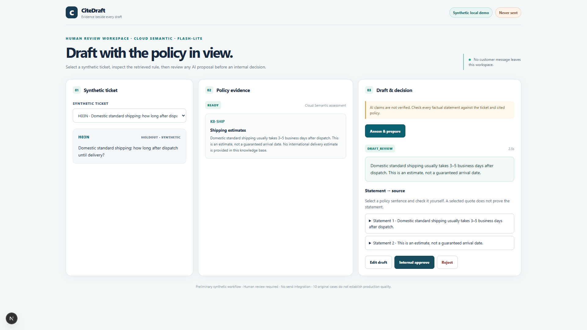
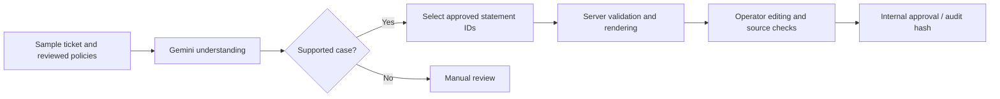

# CiteDraft

A support-reply drafting prototype. An operator reviews the customer's question, company policy and proposed reply side by side, then edits and approves the draft internally.

[Watch the local demo, 74 seconds](https://ilyam-dev-source.github.io/ilyam-dev-source/#citedraft) · [Download MP4](../media/citedraft-demo.mp4) · [Back to profile](../README.md)

## Workflow

1. Gemini reads the ticket and reviewed policy context.
2. For supported cases, a second call selects an action and approved statement IDs. Other cases go to manual review without answer generation.
3. The server validates that selection and builds the draft from reviewed wording.
4. The operator can edit the draft, link each revised statement to an exact policy sentence and mark it checked.
5. Internal approval records the reviewed text and its hash in the audit log. CiteDraft does not send replies to customers.

## Draft validation and review

Structured output lets the server inspect the model's selection. The approved statement catalog limits the wording used to build a draft. A reviewer still needs to check whether the selected action fits the ticket and whether any edits are supported by policy. Source links and checkboxes record that review; they do not automatically verify a claim.

The audit log links the approved text to its ticket, policy, prompt and model versions. This makes a review traceable, while responsibility for checking the reply remains with the operator.

## Recorded example

The October 8 video uses a real Gemini Flash-Lite response to a sample domestic-shipping question. The operator edits the 3 to 5 business day estimate, checks the estimate and the qualification that delivery dates are not guaranteed against policy sentences, then approves the draft internally. The saved text matched the approval hash in the audit log, and the recording had no uncaught browser JavaScript errors.

Both model calls use Flash-Lite in the application's optional Cloud Semantic mode. The clip shows one workflow; the evaluation below covers the broader test set.

## Evaluation and limitations

The October 5 regression tested the application on all 48 synthetic cases in a previously used dataset. Of the 47 cases included in strict scoring, 46 took the expected route and 45 selected the expected action. The author and agent review judged all 29 displayed drafts to be supported by policy. These are results on an authored, reused test set, without independent human grading; they do not estimate accuracy with real customers.

The evaluation record keeps the failed cases and a protocol discrepancy: the original wording required zero external calls for manual cases, while the authorized design used a cloud understanding call before deciding whether to generate an answer. The original record and the later clarification are both preserved.

CiteDraft has no helpdesk connector, customer-message delivery or public model endpoint, and has not been tested with real customers. The public portfolio hosts the recording. An older static replay contains saved results from an earlier version and is excluded from this presentation.
