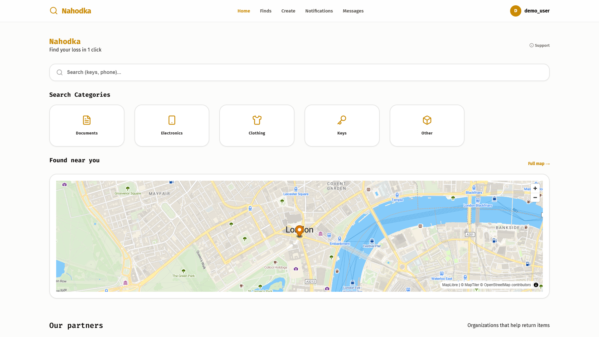
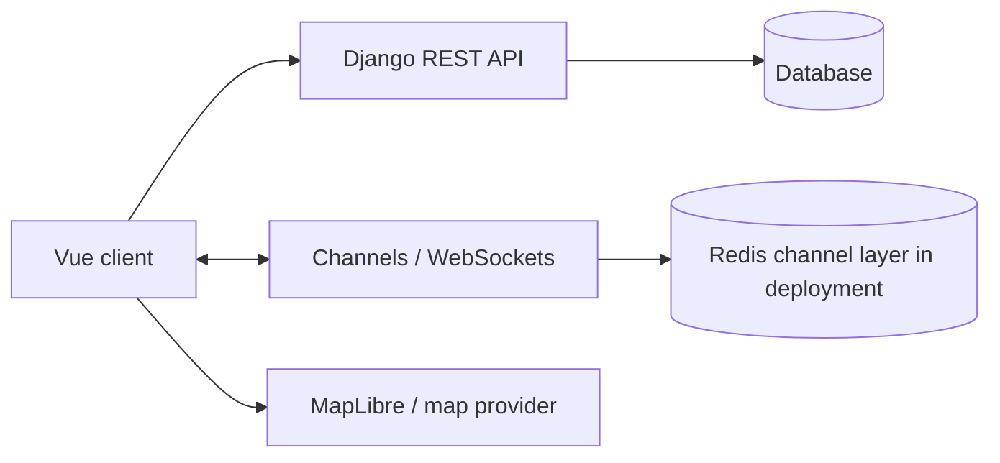

# Nahodka

A lost-and-found service for individuals and partner organizations. People publish lost-item reports, browse found items by category and location, and contact the organization holding a possible match.

[Live demo](https://nahodka-portfolio.onrender.com/) · [Watch the local recording, 89 seconds](https://ilyam-dev-source.github.io/ilyam-dev-source/#nahodka) · [Download MP4](../media/nahodka-demo.mp4) · [Back to profile](../README.md)

## What I built

- A Vue client with a Django REST Framework API, structured listings and role-specific workspaces.
- MapLibre maps and configurable global map/geocoding endpoints.
- Persistent messaging, WebSocket delivery, notifications and partner organization profiles.
- Server-side permissions, cookie-based authentication, CSRF checks and upload validation.
- English-first localization with a persistent Russian option; user content is not automatically translated.

## Architecture

Messages and listings are stored in the database. WebSockets deliver updates while users are connected, and the conversation history remains available when they return. Backend permissions control access to private fields and partner operations.

## What the video shows

A loaded London map, gradual creation of a lost-item report, a Tower Bridge map pin, publication, a found-item category filter, inspection of a possible match and a message to the partner organization.

The category filter finds candidates; confirming a match still requires checking the item. The recording uses sample accounts and listings with SQLite and in-memory channels. The hosted demo uses PostgreSQL and Redis.

## Tests and verification

The October 8 recording completed the report and messaging flow without uncaught browser JavaScript errors. Local checks on October 5 passed 32 Django tests and 18 frontend tests, with zero lint warnings and successful builds. The dependency, secret and static-analysis scans from that run reported no known findings. These results are the October 5 baseline; later deployment checks are separate.

## Live demo and limitations

Nahodka began as my bachelor's project and was later prepared for this portfolio. It has not been validated as a production lost-property service or benchmarked under production load.

The live demo runs on Render with Neon PostgreSQL, private image storage and Redis-backed messaging. Visitors share sample accounts and listings. The service may take about a minute to wake after inactivity; uploads and map requests have quotas. Do not enter personal or confidential information. The video above was recorded locally.
