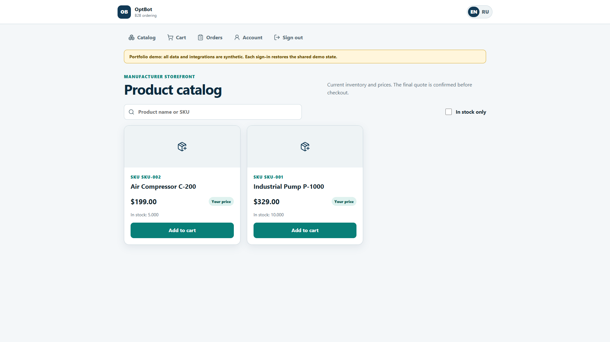
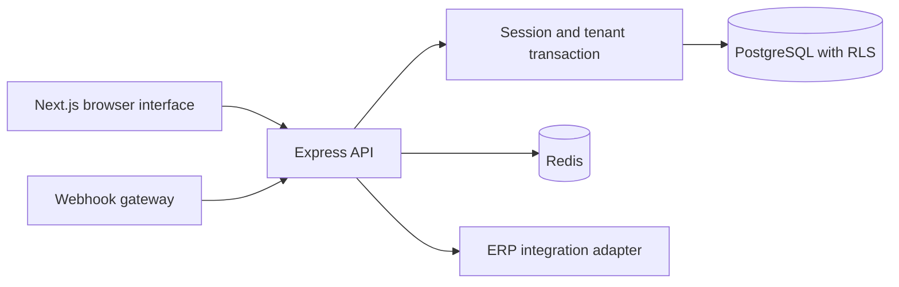

# OptBot

A B2B ordering platform for manufacturers and their dealers. Visitors can browse retail prices; approved dealers see their contract prices and place orders. Supplier managers manage dealer accounts and payment terms in a separate workspace.

[Live demo](https://optbot-portfolio.vercel.app/) · [Watch the local recording, 76 seconds](https://ilyam-dev-source.github.io/ilyam-dev-source/#optbot) · [Download MP4](../media/optbot-demo.mp4) · [Back to profile](../README.md)

## What I built

- A TypeScript monorepo with a Next.js/React web client, Express API and a webhook gateway.
- A public catalog and cart, dealer-specific prices, price verification before checkout and order management.
- PostgreSQL FORCE RLS policies and application permissions to keep tenant data separate.
- Redis caching and rate limits, readiness checks and graceful shutdown.
- ERP adapters, webhook validation, English/Russian localization and PWA support.

## How a request moves through the system

The API sets the request's identity and tenant context inside a transaction before accessing tenant data. PostgreSQL policies enforce isolation even if an application query omits a tenant filter. Order changes and webhook deduplication commit together or roll back together.

## What the video shows

Public catalog, supplier dashboard, dealer sign-in, the dealer's negotiated price, cart review, price verification, order creation and a simulated ERP confirmation.

The catalog, sessions, PostgreSQL RLS and order changes run in the local application. Demo adapters simulate company lookup, email, KMS wrapping and ERP calls. The final confirmation comes from the simulated ERP adapter.

## Tests and verification

The October 8, 2026 recording completed the order flow on the local Docker stack without uncaught browser JavaScript errors. The October 12 CI run passed 228 tests; the external ERP sandbox test was skipped because it requires credentials.

Earlier local checks on October 5 passed 193 tests and the production build, with 75.61% statement coverage and 82.00% line coverage. That run reported no known production dependency vulnerabilities, secret leaks or static-analysis findings. Four High findings remained in development-only ESLint dependencies. These coverage and scan results belong to the October 5 run.

The demo does not test a live ERP connection. That requires a separate run with sandbox credentials.

## Live demo and limitations

OptBot is a self-directed prototype. It has not been validated with customers or under production load, and no revenue is claimed.

The live demo uses Vercel, a Render API and Neon PostgreSQL. External integrations are simulated. Visitors share the same sample data; signing in does not reset orders or end another visitor's session. The API may take about a minute to wake after inactivity. Do not enter personal or confidential information. The video above was recorded locally.
